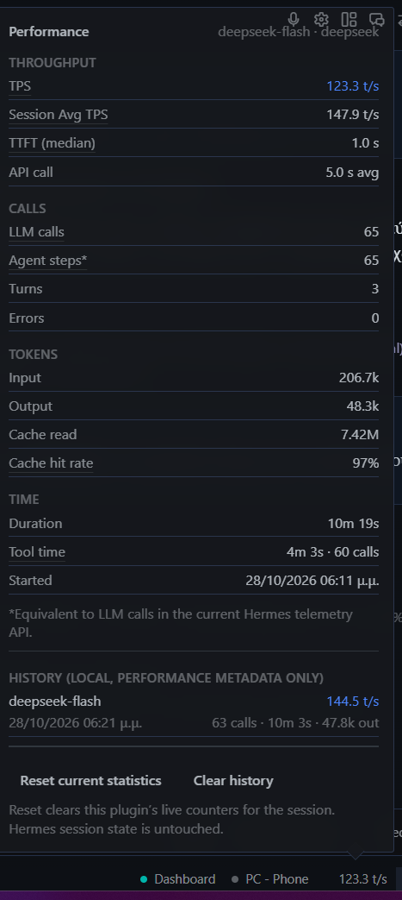

# Hermes Perf HUD

A performance HUD for the [Hermes Agent](https://hermes-agent.nousresearch.com/docs)
desktop app: a status-bar chip that shows what the current turn is actually
costing, and a popover with the full picture — throughput, time to first token,
tokens, cache hit rate, tool time, session duration — plus a local history you can
benchmark models against.

Observation only. The plugin reads public observer hooks, never blocks a tool,
never transforms a message, and never modifies Hermes core. Turn the plugin off
and the agent behaves exactly the same.

```
status bar   ● 96.6 t/s                        ← click the chip
─────────────────────────────────────────────────────────────────
popover      TPS · Session Avg TPS · TTFT · LLM calls ·
             tokens · cache hit rate · tool time · duration ·
             history · [Reset current statistics] [Clear history]
```

## Features

| | |
| --- | --- |
| **Live TPS** | Core-compatible gauge: `Σ output_tokens / Σ api_duration` over the last 10 completed API calls — the same window and arithmetic as Hermes' own CLI status bar. |
| **Session Avg TPS** | The same ratio over every call in the session, always shown under its own label. |
| **TTFT** | Real time from request start to the first streamed chunk, median of the samples Hermes reports. |
| **LLM calls** | Authoritative call count, one per completed provider request (success or failure). |
| **Token counts** | Input, output, cache-read, cache-write and reasoning tokens. |
| **Cache metrics** | Cache hit rate using Hermes' `cache_read / (cache_read + input)` bucket definition. |
| **Tool timing** | Per-tool totals, tool error count, and tool time as a share of measured time. |
| **Session duration** | Wall clock from the first observed event to the latest — never the span of a single API call. |
| **Status-bar chip** | `tps` (`96.6 t/s`), `tps_ttft` (`96.6 t/s · 980ms`) or `calls` (`29 calls`). |
| **Performance popover** | Every metric above in one table, with model and provider identity. |
| **History** | On by default: performance metadata for the last 50 sessions, one JSON file per profile. No content, ever. |
| **Reset / clear controls** | `Reset current statistics` zeroes the plugin's own counters; `Clear history` empties the history file. Neither touches Hermes session state. |

## Screenshots

Real captures from a packaged Hermes Desktop build (no mockups):

| | |
| --- | --- |
|  | The chip at rest (`123.3 t/s`), cropped from the real status bar of the capture below. |
|  | The statistics popover: throughput, calls, tokens, time, history and the two controls. |

## Installation

```bash
# 1. put the plugin where Hermes looks for user plugins
git clone https://github.com/g3org3yo/hermes-perf-hud \
  "$LOCALAPPDATA/hermes/plugins/perf-hud"                 # Windows
#  ~/.local/share/hermes/plugins/perf-hud                   # Linux
#  ~/Library/Application Support/hermes/plugins/perf-hud    # macOS

# 2. optional: structural check (manifest, hooks, SDK surface, security scan)
hermes plugins validate "$LOCALAPPDATA/hermes/plugins/perf-hud"

# 3. enable it — the running gateway picks up the hooks immediately
hermes plugins enable perf-hud

# 4. restart the Hermes desktop app once
```

**Why the restart?** The backend half (hooks, history, REST routes) is live as soon
as the plugin is enabled. The desktop half (`desktop/plugin.js`) is materialised
into `<HERMES_HOME>/desktop-plugins/` by the Electron app **at startup**, so the
chip is painted after the first restart. Until then the numbers are already being
collected — nothing is lost.

Requirements: Hermes Agent `>=0.22.5` (the first release whose desktop SDK exports
`STATUSBAR_AREAS`). Python standard library only; no third-party dependencies.

Uninstall: `hermes plugins disable perf-hud`, or delete the folder. History lives in
`<HERMES_HOME>/plugin-data/agent-plugin-perf-hud-*/history.json` and is yours to delete.

## Configuration

Settings live in the plugin's own documented subtree,
`plugins.entries.perf-hud.settings.*`:

| Key | Default | Meaning |
| --- | --- | --- |
| `chip_enabled` | `true` | Show the chip in the status bar. |
| `chip_metric` | `tps` | Chip text at rest: `tps` (`96.6 t/s`), `tps_ttft` (`96.6 t/s · 980ms`), `calls` (`29 calls`). |
| `history_enabled` | `true` | Keep local performance metadata for recent sessions. |
| `history_max_sessions` | `50` | Records kept in the history file (oldest dropped). |
| `poll_ms` | `5000` | Fallback poll interval for the popover when the live bridge is quiet. |
| `broadcast_min_interval_ms` | `400` | Minimum gap between live snapshot pushes to the desktop. |

```bash
hermes config set plugins.entries.perf-hud.settings.chip_metric calls
```

or edit `config.yaml` directly:

```yaml
plugins:
  entries:
    perf-hud:
      settings:
        chip_metric: tps_ttft
        history_max_sessions: 50
```

## Metrics

The two throughput numbers are different metrics and are never mixed. Full
formulas, edge cases and rounding: [`docs/METRICS.md`](docs/METRICS.md).

### TPS

Hermes-core-compatible throughput over the **latest 10 API calls**:

```
TPS = Σ output_tokens / Σ api_duration     (last 10 completed calls)
```

Sum over sum — not the mean of per-call rates — matching `agent/turn_usage.py`
(`deque(maxlen=10)`) and the CLI status bar. Fewer than one sample → `—`.

### Session Avg TPS

Session-wide output tokens divided by total API latency:

```
Session Avg TPS = Σ output_tokens / Σ api_duration     (every call in the session)
```

Useful for benchmarking a model across a whole session; not a saturation gauge.
Always labelled in full.

### TTFT

Actual time from the start of an LLM request until the first streamed model chunk,
from Hermes' authoritative telemetry (`first_chunk_at − started_at`), reported as
the median of the session's samples with the mean and sample count alongside. A
call without a first-chunk timestamp produces no sample.

### Cache hit rate

Hermes' bucket definition:

```
cache_hit_pct = cache_read_tokens / (cache_read_tokens + input_tokens) × 100
```

A ratio of reported token buckets, not a billing statement. No tokens → `—`.

### LLM calls

Number of recorded LLM/API calls: one increment per completed provider request,
whether it succeeded or errored.

### Agent steps

If your client shows an `Agent steps*` field, it is a compatibility alias:

> `Agent steps*` is equivalent to LLM calls because the current Hermes telemetry
> API does not expose a separate agent-step counter.

The footnote travels inside the snapshot (`agent_steps_note`), so no consumer can
display the alias without it.

## Privacy

**Stored** — the complete history record, nothing else:

```
session_id · model · provider · started_at · updated_at · duration_ms ·
ttft_ms · tps_core · input_tokens · output_tokens · cache_hit_pct ·
tool_time_ms · llm_calls
```

**Never stored**, and not present in any snapshot, event or disk record: prompts,
model responses, conversation contents, tool arguments, tool results, request
bodies, API keys.

Three gates enforce it: handlers copy a fixed field list, `snapshot()` builds a new
dict with no text key, and the history writer persists an allow-list
(`RECORD_FIELDS`). Tests feed payloads carrying a marker string in
prompt/response/argument/result fields and then scan the snapshot, the broadcast
payload and the JSON on disk for it.

**Network requests: none.** The plugin makes no outbound connections. The only
cross-process path is the in-process desktop event bridge
(`broadcast_plugin_event`); the REST routes are served by your own local dashboard.
No credentials, no OAuth, no background service, no subprocess.

## Architecture

```
observer hooks → aggregation → runtime registry → Python→Desktop event bridge
              → Desktop SDK → status-bar chip → popover → optional local history
```

* `__init__.py` registers nine observer hooks and wraps each in a fail-open guard,
  so a telemetry bug can never break a turn.
* `aggregation.py` is pure — events in, snapshot out, no I/O, no host imports.
* `runtime.py` is the single process-wide registry, shared by the hook half and the
  dashboard half through a fixed module name.
* `history.py` persists an allow-listed record per session, atomically, capped at 50,
  quarantining a corrupt file instead of crashing.
* `desktop/plugin.js` renders the chip and popover using only the public
  `@hermes/plugin-sdk` (`STATUSBAR_AREAS`, `Popover`, `Button`, `Separator`) — no DOM
  patching, no internal component access.

Details — hook payload filtering, session identity, process/isolation behaviour,
the privacy boundary and the REST surface — are in
[`docs/ARCHITECTURE.md`](docs/ARCHITECTURE.md).

### REST routes (served by your dashboard at `/api/plugins/perf-hud/`)

| Route | Purpose |
| --- | --- |
| `GET /snapshot` | Focused (or most recent) session snapshot + plugin status. |
| `GET /sessions` | All live sessions + fleet totals. |
| `GET /history?limit=` | Stored records, newest first (1–200). |
| `GET /config` · `POST /config` | Read / write one setting through `ctx.set_config`. |
| `POST /reset` | Zero the plugin's in-memory aggregation for one session (or all). |
| `POST /clear-history` | Empty the history file. Keeps live counters. |
| `GET /status` | Version, tracked sessions, broadcast counters, history stats. |

## Controls

* **Reset current statistics** — clears this plugin's in-memory counters for the
  session and starts counting again from the next event. It does **not** modify
  Hermes session state: no session row, no transcript, no agent counter.
* **Clear history** — empties the plugin's history file. Live counters and Hermes
  session state are untouched.

## Troubleshooting

**The chip does not appear.** The desktop half is copied into
`<HERMES_HOME>/desktop-plugins/` at app startup. Quit and reopen the desktop app
after enabling, then confirm the backend is alive with `hermes plugins list` and
`GET /api/plugins/perf-hud/status` (with the dashboard's auth ticket).

**TTFT shows `—`.** Hermes did not report `first_chunk_at` for those calls (some
providers and some non-streaming paths do not). No sample is invented; other
metrics are unaffected.

**TPS shows `—` right after a reset.** The core window needs one completed call.
It fills within the first response.

**Numbers differ between windows.** If `dashboard.turn_isolation` runs turns in a
compute-host child process, the child keeps its own in-memory counters: live events
still arrive, but `/snapshot` in the parent will not see them. History is on shared
disk, so `/history` stays complete. `hermes plugins validate` prints the isolation
mode.

**Turns stays at 0 while LLM calls keeps climbing.** Correct behaviour: a turn is
counted when it completes, and one turn can contain dozens of LLM calls (an agent
loop, sub-agents, retries). The counter moves at the end of the turn, so a single long
turn shows `Turns 0` with a high `LLM calls` until it finishes.

**History is empty.** `history_enabled` must be on and the session needs a real
`session_id` (events without one are aggregated but never persisted). Writes are
throttled to one per session per 5 seconds, so a brand-new session may take a
moment to appear.

**History file looks broken.** It is quarantined automatically as
`history.json.corrupt-<stamp>` and a fresh file is started; nothing else is affected.

**Popover shows stale numbers.** The bridge throttles pushes to
`broadcast_min_interval_ms` (400 ms). Lower it for faster updates; the popover also
polls every `poll_ms`.

**REST calls return 404.** Every `/api/plugins/*` route requires the dashboard's
auth ticket; unauthenticated requests get a masked 404, not a 401.

## Development

```bash
cd tests
python -m unittest discover -v          # 65 tests, stdlib only — no pytest needed
```

```bash
hermes plugins validate "$LOCALAPPDATA/hermes/plugins/perf-hud"
node --check desktop/plugin.js          # after copying it to a .mjs file
```

`tests/test_api.py` mounts the real FastAPI router through `TestClient` and skips
cleanly when FastAPI is absent. Contributions: keep the aggregation layer pure, keep
handlers read-only, and keep every persisted field inside `RECORD_FIELDS`.

## License

MIT — see [LICENSE](LICENSE).
